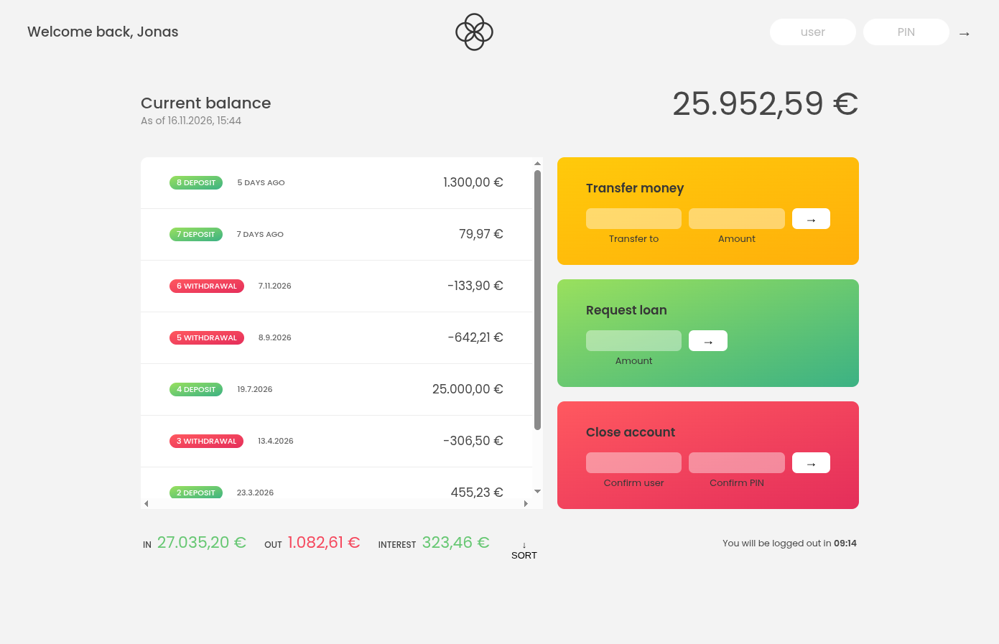

# Bankist

Bankist is a polished banking dashboard built with plain HTML, CSS, and JavaScript. It simulates a modern online banking experience with a secure login flow, account activity tracking, transfers, loans, and an automatic logout timer.

## Screenshot Preview



🔗 **Live demo:** [bankist-ri.netlify.app](https://bankist-ri.netlify.app)

## Features

- User login with demo credentials
- Live balance calculation and updates
- Transaction history with formatted dates
- Account summary for income, expenses, and interest
- Internal transfers between users
- Loan request simulation based on account activity
- Account closure flow with PIN confirmation
- Auto logout timer for a realistic banking workflow
- Clean, responsive fintech-style interface

## Demo Accounts

Use these demo accounts to explore the app:

- `js` / `1111`
- `jd` / `2222`

## Project Structure

```text
Bankist/
├── index.html
├── style.css
├── script.js
├── logo.png
├── icon.png
├── Bankist-flowchart.png
├── LICENSE
├── README.md
```

## Tech Stack

- HTML5
- CSS3
- JavaScript (ES6+)
- Intl API for formatting dates and currencies

## License

This project is licensed under the MIT License.
